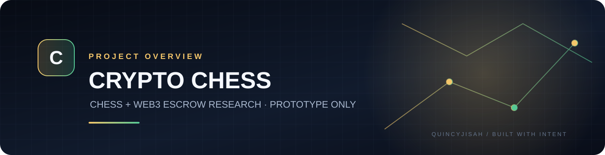

# Crypto Chess — Stablecoin Wager Lobby Concept

**Purpose:** A chess-focused Web3 product concept exploring match lobbies, transparent wager accounting and smart-contract escrow design.
**Built for:** Chess players, Web3 game builders and smart-contract engineers researching fair, verifiable game settlement.
**Stage:** Prototype and research only. This public repository currently contains project documentation and a landing-page scaffold; it is not a deployable wagering service.

## Important status

- No live wallet connection or funded game is enabled in this repository.
- No production escrow contract is deployed from this repository.
- No real wagers, deposits, payouts or token transfers are supported.
- No independent smart-contract audit or mainnet approval is claimed.
- Separate private contract work must be reviewed and deployed independently before it can be considered operational.

## Intended direction

- Verifiable two-player chess matches.
- Explicit stake and fee rules before a match begins.
- Escrow settlement with dispute and timeout handling.
- Anti-cheat controls and auditable match events.
- Separation between game logic, contract custody and user-interface state.

## Release gates

Wallet authentication, deployed and independently audited contracts, secure match orchestration, anti-cheat review, operational monitoring, legal review and end-to-end adversarial testing are required before real-value play.