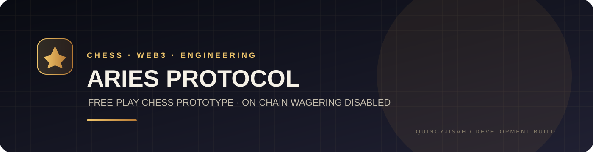

  

# Aries Protocol — Crypto Chess Arena

**Purpose:** Build a chess-focused Web3 game prototype with free-play chess, tournament concepts, auditable game flows and a separately developed smart-contract escrow layer.

**Built for:** Chess players, Web3 game developers, tournament operators and smart-contract engineers researching transparent match and settlement systems.

**Current stage:** Development prototype. Free-play and selected read-only wallet features are present; deposits, withdrawals, payouts and on-chain wagering are disabled. No mainnet wagering service is live. Rules and NFT policy documents are drafts, not effective customer terms.

## What is in this workspace

- Vite / React / TypeScript game interface with chess, replay and tournament views.
- Firebase integration and security rules for the prototype's application data.
- Wallet connection and read-only balance inspection.
- Separate Solidity contracts for escrow and Genesis NFT concepts.
- Hardhat compile, contract tests and deployment-policy tests in `backend/contracts-workspace`.
- A separate WebSocket/backend experiment under `backend/`.

These components are not a single, fully integrated production wagering service. A wallet connection or displayed token balance is not evidence of a deposit, a funded escrow, or a withdrawable balance. The local escrow currently defines a 2% winner-settlement fee and full refunds on a draw; any other terms in draft policy documents must not be treated as live contract behaviour.

## Local development

Requirements: Node.js 20+ and npm.

~~~bash
npm ci
npm run dev
npm run lint
npm test
npm run build
~~~

The Vite development server listens on port 3000 by default.

### Smart-contract workspace

From `backend/contracts-workspace`:

~~~bash
npm ci
npm run compile
npm test
~~~

The scripts invoke the Hardhat workspace for local compilation and tests. **Do not run `deploy:sepolia` or `deploy:mainnet` as part of ordinary development.** No production deployment is implied by a successful local contract test.

### Backend experiment

The Node.js backend under `backend/` is a separate service. Its deployment, environment, persistence, WebSocket authentication and operations need independent staging verification before it can be connected to a public game frontend.

## Safety and release boundary

- The coin-flip and practice interfaces are local/demo-only; they do not wager funds.
- Free-play tournaments must remain zero-entry and must not imply cash or token prizes.
- Wallet integration is for connection and read-only balance inspection in the current frontend.
- Ledger records are not proof of on-chain deposits, withdrawals or settlement.
- Contract code and tests have not received an independent security audit.
- No mainnet contract deployment or production wagering release is approved.

## Deployment status

The current Vercel project named `aries-blackjack` is mislinked to the LeadPilot GitHub repository. Its most recent build failed because Vercel expected a static `public` output directory. The full Aries application is currently present in this local workspace, but the public `CRYPTO-CHESS-USTD` repository does not yet contain this complete application source. See [the deployment status record](../docs/DEPLOYMENT_STATUS.md).

Do not treat the existing Vercel URL or its READY/ERROR deployment records as a release of this Aries application.

## Before any public real-value launch

1. Publish the reviewed application into a dedicated Git repository with a clean, reproducible source tree.
2. Separate the frontend, backend and contract deployment targets with explicit build and runtime boundaries.
3. Independently audit the escrow and NFT contracts and exercise all state transitions on a testnet.
4. Verify wallet ownership, anti-cheat, match finality, timeout recovery, disputes, refunds and idempotency end to end.
5. Establish key custody, multisig governance, monitoring, incident response and emergency pause/recovery procedures.
6. Complete applicable gambling, consumer, privacy and cryptoasset regulatory review for the target jurisdictions.
7. Complete physical-device/browser testing and independent application penetration testing.

No real-value wagering, payouts or deposits should be enabled until those gates are closed and recorded.
